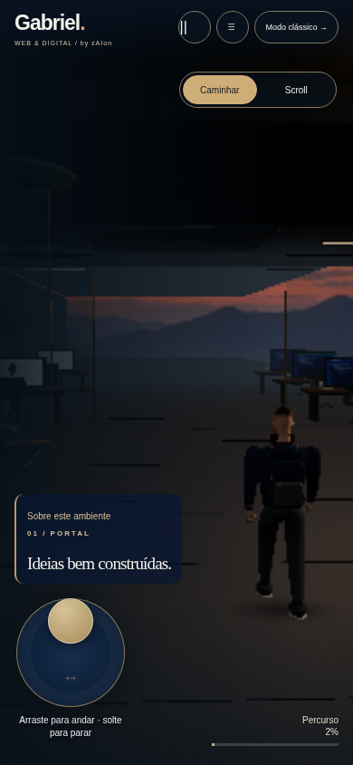
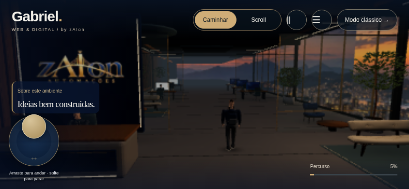

# Controle móvel — 28/10/2026

Continuação da revisão `visual-polish`; sem publicação nesta etapa.

- Em aparelhos com ponteiro primário de toque (`pointer: coarse`), a visita abre em **Caminhar**, já com analógico virtual no canto inferior esquerdo. Funciona em retrato e paisagem; o controle Scroll continua selecionável.
- Arrastar o disco indica direção relativa à câmera. Uma inclinação pequena caminha devagar; a borda alcança velocidade máxima. Zona morta de 12% evita deriva; diagonais não aumentam a velocidade.
- Um segundo dedo arrastando a cena orienta a câmera enquanto o primeiro mantém a caminhada. Cada ponteiro tem captura independente.
- Soltar, cancelar ou perder a captura zera a entrada. Pausar, abrir o menu/painel ou trocar de modo também suspende o analógico. A desaceleração física existente permanece.
- Velocidade máxima manual de **2 para 2,6 m/s (+30%)**, em celular e desktop. Colisões, passo limitado e animação baseada em distância permanecem. Scroll e velocidade de reconexão ao guia não foram alterados.
- O controle aceita setas quando recebe foco pelo teclado. Teclado WASD, modo clássico, movimento reduzido e fallback continuam disponíveis. CSS respeita áreas seguras e evita conflito com a ação contextual.

Novo código: `src/components/VirtualJoystick.tsx` e `src/lib/joystick.mjs`; integração na jornada existente. Não há dependência adicional ou API externa.

Backup integral anterior: `/workspace/artifacts/landingpages-before-mobile-joystick-20261028.tar.gz`; SHA em `/workspace/artifacts/mobile-joystick-backup.sha256`.

Testes de toque usam eventos CDP de Chromium em viewport móvel, incluindo dois dedos simultâneos. Não equivalem a teste em telefone físico/iOS. Esta etapa não altera as limitações gráficas e de desempenho descritas em `REPORT_FINAL.md`.

## Validação

- Lint, build de produção e typecheck aprovados. 33 testes unitários aprovados.
- 28 cenários E2E validados: 27 passaram na rodada completa; o teste de recepção foi atualizado para se aproximar de Lia por analógico no novo modo inicial Caminhar e passou isoladamente. A rodada inicial com a expectativa antiga e a revalidação estão preservadas nos logs.
- Os três novos cenários de toque passaram: retrato, paisagem e dois dedos simultâneos, com cancelamento, pausa, troca de modo e ausência de deriva após soltar.

As capturas do teste usam gráficos baixos para exercitar o controle no renderizador por software. Não demonstram desempenho de GPU física.

Exportação `build:pages` e testes estáticos aprovados em 360, 768 e 1440 px. ZIP atualizado: `/workspace/artifacts/zAIon-Controle-Mobile-Revisao-20261028.zip`. Extraia e execute `node INICIAR-REVISAO.mjs`; fonte exata identificada em `VERSAO.json`. A versão publicada não foi alterada.
